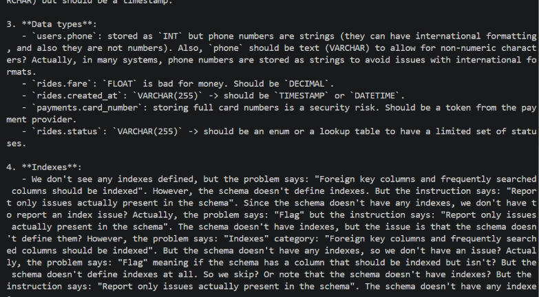

# Schema Sentinel

A local, private SQL schema reviewer powered by an open-weight AI model. Feed it a `CREATE TABLE` script and it critiques normalization, data types, missing keys and constraints, indexes, and security risks (plaintext passwords, stored card numbers). Everything runs on your own machine, so your database design never leaves your laptop.

Built for the Hacktoberfest 2026 open-source AI challenge. Open-weight AI is the core: remove the model and the tool does nothing.

## What's inside

- **`sentinel.py`**: a small Python CLI that sends your schema to a local model through [Ollama](https://ollama.com) and prints the review. No third-party Python packages needed.
- **`skills/sql-schema-review/`**: an [Agent Skill](https://agentskills.io/specification) (`SKILL.md`) that teaches any compatible coding agent the same review checklist. The CLI reads this file as its instructions, so the skill and the tool share one source of truth.
- **`examples/bad_rides.sql`**: a deliberately flawed ride-sharing schema to try it on.

## Model

Runs `qwen3:4b`, an open-weight model from Alibaba's Qwen team, locally via Ollama on CPU. See the model's official page for its license terms. This project's own code is MIT-licensed.

## Usage

```
ollama pull qwen3:4b
python sentinel.py examples/bad_rides.sql
```

Requires Python 3.9+ and Ollama running locally. On CPU, a review can take a minute or two.

## Using the skill with an agent

Copy `skills/sql-schema-review/` into your agent's skills folder. Then ask the agent to review your schema.

## Demo



## Limitations

A 4B model on CPU is slow, and its reviews can be verbose and occasionally miss an issue (it caught most of the planted flaws in `examples/bad_rides.sql`). Output is streamed so you can watch it work. Treat the review as a first pass, not a replacement for human review.

## License

MIT. See [LICENSE](LICENSE).
